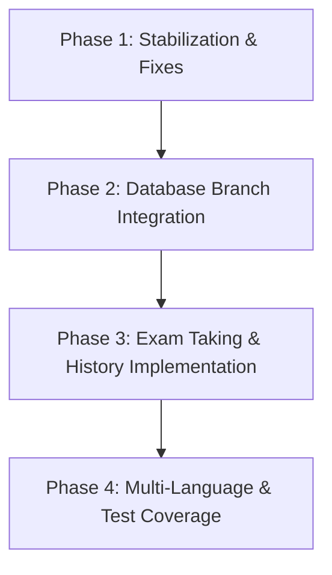

# MaturiMate — Codebase Audit & Architectural Status Report

**Date:** October 2026  
**Auditor:** Senior Software Architect & Tech Lead  
**Repository:** `MadovyGabor/MaturiMate`  
**Current Active Branch:** `main` (with unmerged remote `origin/database`)

---

## Executive Summary

**MaturiMate** is a modern, cross-platform study companion application built with **Kotlin Multiplatform (KMP)** and **Compose Multiplatform**, targeting **Android** and **Desktop (JVM)**. Its primary mission is preparing students for the Slovak high school graduation exams (*Maturita* / *Érettségi*), offering tailored tracks for Hungarian and Slovak language schools, difficulty levels (B1/B2 English), and key subjects (Hungarian, Slovak, English, Math).

The project is cleanly structured following modern KMP standards (Koin, AndroidX DataStore, Navigation3, Material 3). Core architecture and the initial onboarding and user profile journeys are solidly implemented and functional. However, the core domain feature (exam taking, questions database, and history) is currently stubbed out on `main`. 

> [!IMPORTANT]
> **Critical Audit Finding:** A dedicated remote feature branch, [`origin/database`](file:///c:/Users/madov/StudioProjects/MaturiMate), contains 2 unmerged commits implementing the entire SQLDelight database layer, schema (`ExamEntity`, `TaskEntity`, `ContentUnitEntity`, `UserProgressEntity`), database seeder, and real exam data (`HU_MJL_2025.json`). Re-integrating this branch should be top priority.

---

## 1. Project Overview & Tech Stack

### 1.1 Purpose
MaturiMate serves high school students in Slovakia preparing for the central Maturita examinations. It offers:
- Study organization and countdown to exam dates.
- Profile customization for examination track (Slovak vs. Hungarian section) and English level (B1 vs. B2).
- Special educational needs support toggle (VPUS / SNI).
- Subject and exam test paper selection and practice (under active development).

### 1.2 Technology Stack
| Category | Technology | Version | Purpose |
| :--- | :--- | :--- | :--- |
| **Language** | Kotlin Multiplatform | `2.2.20` | Shared logic and UI for Android & JVM |
| **UI Framework** | Compose Multiplatform | `1.9.1` | Declarative UI across Android and Desktop |
| **Design System** | Material 3 | `1.7.3` icons | Adaptive design (Mobile Scaffold & Desktop NavigationRail) |
| **DI** | Koin | `4.1.1` | `koin-core`, `koin-compose`, `koin-compose-viewmodel` |
| **Local Storage** | AndroidX DataStore | `1.2.0` | Typed Preferences persistence across platforms |
| **Database** | CashApp SQLDelight | `2.2.1` | Local SQLite database (configured on `origin/database`) |
| **Navigation** | AndroidX Navigation3 | `1.0.0-alpha06` | Type-safe declarative navigation backstacks |
| **Serialization**| `kotlinx.serialization` | `1.9.0` | JSON serialization & Navigation3 route state |
| **Time & Date** | `kotlinx-datetime` | `0.7.1` | Date handling and days countdown calculation |
| **Build System** | Gradle | `8.14.3` | Version Catalog (`libs.versions.toml`), Foojay toolchain resolver |
| **Android AGP** | Android Gradle Plugin | `8.13.0` | `compileSdk 36`, `minSdk 24`, `targetSdk 36` |

### 1.3 Build System & Dependency Health
- **Gradle Version Catalog**: Centralized in [gradle/libs.versions.toml](file:///c:/Users/madov/StudioProjects/MaturiMate/gradle/libs.versions.toml).
- **Toolchain Resolution**: Uses `org.gradle.toolchains.foojay-resolver-convention:1.0.0` in [settings.gradle.kts](file:///c:/Users/madov/StudioProjects/MaturiMate/settings.gradle.kts).
- **Outdated / Deprecated Dependencies & Warnings**:
  - `cmpNavigation3` is currently on early alpha (`1.0.0-alpha06`).
  - `androidx-lifecycle` is on alpha (`2.10.0-alpha07`).
  - Deprecation warning in [FormattedDateString.kt](file:///c:/Users/madov/StudioProjects/MaturiMate/composeApp/src/commonMain/kotlin/com/madovygabor/maturimate/features/profileDetails/presentation/components/FormattedDateString.kt#L25): `LocalDate.dayOfMonth` is deprecated in `kotlinx-datetime 0.7.x`; use `.day` instead.
  - SQLDelight library dependencies exist in [composeApp/build.gradle.kts](file:///c:/Users/madov/StudioProjects/MaturiMate/composeApp/build.gradle.kts#L48-L50), but the SQLDelight Gradle plugin is not applied on `main`.

---

## 2. Architecture & Code Structure

### 2.1 High-Level Architecture
The project applies **Clean Architecture** patterns separated into `core` and `features` modules within the `:composeApp` subproject:
```
composeApp/src/
├── commonMain/kotlin/com/madovygabor/maturimate/
│   ├── App.kt                            # Root Composable and AppTheme wrapper
│   ├── core/
│   │   ├── di/                           # Koin dependency injection modules
│   │   ├── domain/error/                 # OperationResult & generic error models
│   │   ├── presentation/
│   │   │   ├── navigation/               # Type-safe Navigation3 root & sub-graphs
│   │   │   ├── theme/                    # Color, Typography, Material3 Theme
│   │   │   ├── uiComponents/             # Shared UI components (DatePickerField, Dialogs)
│   │   │   └── utils/                    # UiText, LayoutConstants, Static data
│   │   └── database/                     # (Present on origin/database branch)
│   └── features/
│       ├── appOnboarding/                # User onboarding & initial configuration
│       │   ├── data/                     # DataStore preferences repository implementation
│       │   ├── domain/                   # Business models, repository interface, validator
│       │   └── presentation/             # WelcomeScreen, ProfileSetupScreen, ViewModels
│       ├── profileDetails/               # Profile viewing and modal setting edits
│       ├── subjects/                     # Subject overview & exam selection (mocked on main)
│       └── examTaking/                   # Exam viewer / exam writing runner (stub)
├── androidMain/                          # MainActivity, Edge-to-Edge, Splash, Android DataStore
└── jvmMain/                              # Desktop entrypoint main.kt, Desktop DataStore
```

### 2.2 Navigation Architecture
Built with the new **Navigation3** component:
- Root routes defined as `@Serializable sealed interface Route : NavKey` in [Route.kt](file:///c:/Users/madov/StudioProjects/MaturiMate/composeApp/src/commonMain/kotlin/com/madovygabor/maturimate/core/presentation/navigation/Route.kt).
- Root router in [NavigationRoot.kt](file:///c:/Users/madov/StudioProjects/MaturiMate/composeApp/src/commonMain/kotlin/com/madovygabor/maturimate/core/presentation/navigation/NavigationRoot.kt) handles top-level routing between `Route.AppOnboarding`, `Route.Main`, and `Route.ExamWrite`.
- Main screen container in [MainFrame.kt](file:///c:/Users/madov/StudioProjects/MaturiMate/composeApp/src/commonMain/kotlin/com/madovygabor/maturimate/core/presentation/MainFrame.kt) provides an **adaptive navigation pattern**:
  - Screen width `< 600.dp`: Renders Material 3 `NavigationBar` (bottom bar) with a standard `Scaffold`.
  - Screen width `≥ 600.dp`: Renders Material 3 `NavigationRail` (side rail) with 100.dp width.
- Multi-stack backstack management in [MainFrameNavigationState.kt](file:///c:/Users/madov/StudioProjects/MaturiMate/composeApp/src/commonMain/kotlin/com/madovygabor/maturimate/core/presentation/navigation/MainFrame/MainFrameNavigationState.kt) preserves independent navigation stacks per tab.

### 2.3 State Management & Dependency Injection
- **State Flow**: ViewModels expose immutable `StateFlow<UiState>` to composables via `collectAsState()`.
- **Dependency Injection**: Koin 4.1.1 cleanly binds interfaces to implementations:
  - `UserPreferencesRepositoryImpl` bound to `UserPreferencesRepository`.
  - Singletons for `MaturitaValidator` and `SnackbarController`.
  - Scoped ViewModels (`OnboardingViewModel`, `ProfileViewModel`).

---

## 3. Feature Implementation Status

| Feature / Screen | Status | Implementation Details |
| :--- | :--- | :--- |
| **Native Splash & Route Resolution** | **Complete** | In [MainActivity.kt](file:///c:/Users/madov/StudioProjects/MaturiMate/composeApp/src/androidMain/kotlin/com/madovygabor/maturimate/MainActivity.kt) and [main.kt](file:///c:/Users/madov/StudioProjects/MaturiMate/composeApp/src/jvmMain/kotlin/com/madovygabor/maturimate/main.kt), reads DataStore `isSetupCompleted` flag; directs existing users to `Route.Main` and new users to `Route.AppOnboarding`. |
| **Welcome Screen** | **Complete** | Responsive onboarding welcome screen with adaptive font sizing, hero illustration, and CTA button. |
| **Profile Setup** | **Complete** | User selects language track (HU / SK), English level (B1 / B2), exam date (Material 3 DatePicker), and VPUS support toggle with validation. |
| **Adaptive Main Frame** | **Complete** | Responsive switching between bottom navigation and side rail depending on layout breakpoint (`600.dp`). |
| **Profile & Settings** | **Complete** | Displays days remaining until graduation, exam track, and level. Supports in-place dialog edits with draft-state separation. |
| **Subjects Overview** | **Mocked / Partial** | [SubjectListTabScreen.kt](file:///c:/Users/madov/StudioProjects/MaturiMate/composeApp/src/commonMain/kotlin/com/madovygabor/maturimate/features/subjects/presentation/SubjectListTabScreen.kt) displays 4 subjects (Math, English, Slovak, Hungarian), but uses a hardcoded local list and duplicate data class. |
| **Exam Selection** | **Mocked / Incomplete** | [ExamSelectionScreen.kt](file:///c:/Users/madov/StudioProjects/MaturiMate/composeApp/src/commonMain/kotlin/com/madovygabor/maturimate/features/subjects/presentation/ExamSelectionScreen.kt) renders 9 dummy items (`2011`–`2019`) with placeholder text. No click action or exam loading. |
| **Exam Taking (`ExamWrite`)** | **Stub / Empty** | [ExamWriteScreen.kt](file:///c:/Users/madov/StudioProjects/MaturiMate/composeApp/src/commonMain/kotlin/com/madovygabor/maturimate/features/examTaking/ExamWriteScreen.kt) is just an empty `Box` with a placeholder text. |
| **History Screen** | **Stub / Empty** | Inline 5-line placeholder `Text("History Screen")` in [MainFrameNavigation.kt](file:///c:/Users/madov/StudioProjects/MaturiMate/composeApp/src/commonMain/kotlin/com/madovygabor/maturimate/core/presentation/navigation/MainFrame/MainFrameNavigation.kt#L55-L63). |
| **Database & Seeder** | **Missing on `main`, Ready on branch** | Completely implemented on remote branch `origin/database` with SQLite tables and JSON seeder. |

### Code Markings & Annotations
- `// TODO: Use Koin to inject the ViewModel` in [ExamSelectionScreen.kt:L39](file:///c:/Users/madov/StudioProjects/MaturiMate/composeApp/src/commonMain/kotlin/com/madovygabor/maturimate/features/subjects/presentation/ExamSelectionScreen.kt#L39).
- `// TODO: UiText verzió, ha szükség lesz rá` in [FormattedDateString.kt:L28](file:///c:/Users/madov/StudioProjects/MaturiMate/composeApp/src/commonMain/kotlin/com/madovygabor/maturimate/features/profileDetails/presentation/components/FormattedDateString.kt#L28).
- `// TODO Implement platform-specific database client` in [DbClient.kt:L4](file:///c:/Users/madov/StudioProjects/MaturiMate/composeApp/src/commonMain/kotlin/com/madovygabor/maturimate/core/di/DbClient.kt#L4).
- `// TODO: Use image not emoji` in [LanguageSelector.kt](file:///c:/Users/madov/StudioProjects/MaturiMate/composeApp/src/commonMain/kotlin/com/madovygabor/maturimate/features/appOnboarding/presentation/profileSetup/components/LanguageSelector.kt#L26).

---

## 4. Health, Testing & Configuration

### 4.1 Test Suite Status
- **Common Tests**: Only [ComposeAppCommonTest.kt](file:///c:/Users/madov/StudioProjects/MaturiMate/composeApp/src/commonTest/kotlin/com/madovygabor/maturimate/ComposeAppCommonTest.kt) exists with a trivial `assertEquals(3, 1 + 2)`.
- **Test Coverage**: **0%**. No automated tests exist for:
  - `MaturitaValidator` (date in past, date too far, null date).
  - `UserPreferencesRepositoryImpl` (DataStore persistence & mapper).
  - `OnboardingViewModel` / `ProfileViewModel` state transitions.

### 4.2 Configuration & CI/CD
- **Environment variables / `.env`**: None required for the current offline architecture.
- **CI/CD Pipelines**: No GitHub Actions workflows (`.github/workflows`) or build automations configured.
- **Docker**: None (typical for client KMP apps).
- **Git Ignore**: Properly ignores build caches, IntelliJ/Gradle state, `.DS_Store`, and the desktop DataStore file (`prefs.preferences_pb`).

### 4.3 Buildability Audit
- **Android Debug Build**: **PASSED** (`./gradlew :composeApp:assembleDebug` completed in 14s).
- **Desktop JVM Compilation**: **PASSED** (`./gradlew :composeApp:compileKotlinJvm` completed in 10s).
- **Test Suite**: **PASSED** (`./gradlew :composeApp:allTests` completed in 32s).

---

## 5. Technical Debt & Identified Risks

### Critical Issues
1. **Machine-Specific Java Path Breaking Builds**:
   - In [gradle.properties](file:///c:/Users/madov/StudioProjects/MaturiMate/gradle.properties#L4), `org.gradle.java.home=C\:\\Program Files\\Android\\Android Studio\\jbr` was hardcoded.
   - When Android Studio upgraded its bundled JBR to **Java 25** (`25.0.3`), Gradle 8.14.3's Kotlin DSL parser crashed with:
     ```
     java.lang.IllegalArgumentException: 25.0.3
     at org.jetbrains.kotlin.com.intellij.util.lang.JavaVersion.parse(...)
     ```
   - **Remedy**: Configured `org.gradle.java.home` to use a stable Java 21 JDK (`C:\Users\madov\.jdks\jbr-21.0.11`). For long-term stability, Gradle Toolchains should manage the JDK rather than machine-specific paths in `gradle.properties`.

2. **Silent State Loss Bug in `ProfileViewModel`**:
   - In [ProfileViewModel.kt:L126](file:///c:/Users/madov/StudioProjects/MaturiMate/composeApp/src/commonMain/kotlin/com/madovygabor/maturimate/features/profileDetails/presentation/ProfileViewModel.kt#L126), when saving profile modifications, `isVpuEnabled` is hardcoded to `false`:
     ```kotlin
     val saveResult = repository.saveUserPreferences(
         maturitaLanguage = finalLanguage,
         maturitaLevel = finalLevel,
         maturitaDate = finalDate ?: currentState.maturitaDate!!,
         isVpuEnabled = false // BUG: Silently resets user's VPUS preference!
     )
     ```
   - **Impact**: Any user who enables VPUS support during onboarding will have it permanently turned off the first time they change their exam date, track, or level in their profile.

3. **Missing Package Declaration in `FormattedDateString.kt`**:
   - [FormattedDateString.kt](file:///c:/Users/madov/StudioProjects/MaturiMate/composeApp/src/commonMain/kotlin/com/madovygabor/maturimate/features/profileDetails/presentation/components/FormattedDateString.kt) resides in `features/profileDetails/presentation/components/` but has no `package` header.
   - Consequently, it belongs to the root default package, forcing an unusual `import toFormattedDateString` in [ProfileScreen.kt:L47](file:///c:/Users/madov/StudioProjects/MaturiMate/composeApp/src/commonMain/kotlin/com/madovygabor/maturimate/features/profileDetails/presentation/ProfileScreen.kt#L47).

4. **Desktop DataStore File Path Risk**:
   - In [AppModul.jvm.kt:L17](file:///c:/Users/madov/StudioProjects/MaturiMate/composeApp/src/jvmMain/kotlin/com/madovygabor/maturimate/core/di/AppModul.jvm.kt#L17), the desktop preferences file is saved as `"prefs.preferences_pb"` relative to the current working directory instead of the user's home directory (`System.getProperty("user.home")`). This leaves artifacts in the project root during local testing.

### Code Smells & Architectural Inconsistencies
- **Model Duplication**: [SubjectListTabScreen.kt](file:///c:/Users/madov/StudioProjects/MaturiMate/composeApp/src/commonMain/kotlin/com/madovygabor/maturimate/features/subjects/presentation/SubjectListTabScreen.kt#L86-L92) defines a local `data class Subject`, conflicting with the canonical [StatickUiSettings.kt:Subject](file:///c:/Users/madov/StudioProjects/MaturiMate/composeApp/src/commonMain/kotlin/com/madovygabor/maturimate/core/presentation/utils/StatickUiSettings.kt#L20-L26).
- **Unwired ViewModel**: `SubjectViewModel` in [SubjectViewModel.kt](file:///c:/Users/madov/StudioProjects/MaturiMate/composeApp/src/commonMain/kotlin/com/madovygabor/maturimate/features/subjects/presentation/SubjectViewModel.kt) is not injected via Koin, produces dummy strings `(1..4).map { "Subject $it" }`, and is not referenced by any UI screen.
- **Filename Typo (Resolved)**: Renamed [UserPreferencesRepositoryImpl.kt](file:///c:/Users/madov/StudioProjects/MaturiMate/composeApp/src/commonMain/kotlin/com/madovygabor/maturimate/features/appOnboarding/data/UserPreferencesRepositoryImpl.kt) to match class `UserPreferencesRepositoryImpl`.
- **Localization Debt**: UI text across `WelcomeScreen`, `ProfileSetupScreen`, `ProfileScreen`, and `NavItem` is hardcoded in Hungarian. The Slovak resources file [values-sk/string.xml](file:///c:/Users/madov/StudioProjects/MaturiMate/composeApp/src/commonMain/composeResources/values-sk/string.xml) actually contains Hungarian copy.

---

## 6. Recommended Next Steps & Roadmap



### Phase 1: Stabilization & Bug Fixes (Immediate)
1. **Fix `ProfileViewModel` VPUS reset bug**: Preserve `prefs.isVpuEnabled` during profile updates.
2. **Normalize `FormattedDateString.kt`**: Add `package com.madovygabor.maturimate.features.profileDetails.presentation.components` and fix imports.
3. **Fix Desktop DataStore directory**: Point storage to `System.getProperty("user.home") + "/.maturimate/prefs.preferences_pb"`.
4. **Clean up `gradle.properties`**: Avoid committing brittle local absolute paths; rely on Gradle toolchains.
5. **Rename `UserPreferencesRepositoryImp.kt`** to `UserPreferencesRepositoryImpl.kt`.

### Phase 2: Database Branch Integration (High Priority)
1. **Inspect and merge `origin/database` into `main`**:
   - The branch replaces `features/subjects` with `features/subjectsAndExams`.
   - Incorporates real SQLDelight tables (`ExamEntity`, `ContentUnitEntity`, `TaskEntity`, `UserProgressEntity`).
   - Hooks up `HU_MJL_2025.json` data seeding logic.
2. **Wire SQLDelight with Koin**:
   - Verify Android and JVM SQLite drivers.
   - Register `ExamRepositoryImpl` in `sharedModule`.

### Phase 3: Core Exam Flow Development (Feature Sprint)
1. **Connect `ExamSelectionScreen` to `ExamRepository`**: Display real available years/exams per subject rather than dummy "2011–2019" loops.
2. **Implement `ExamWriteScreen`**:
   - Render reading comprehension content units and tasks.
   - Add input components for student answers.
   - Calculate and display scores upon submission.
3. **Implement `HistoryScreen`**:
   - Query `UserProgressEntity` to display completed exams, date taken, and achieved scores.

### Phase 4: Localization & Automated Testing
1. **Translate `values-sk` and extract hardcoded strings**: Migrate all Hungarian hardcoded strings in screens to Compose Resources (`Res.string.*`).
2. **Unit Tests**:
   - `MaturitaValidatorTest` covering edge cases.
   - `ExamMapperTest` and `DatabaseSeederTest`.
   - `OnboardingViewModelTest` and `ProfileViewModelTest`.
3. **Set up GitHub Actions CI**:
   - Automated `./gradlew :composeApp:allTests` and `:composeApp:assembleDebug` on pull requests.
